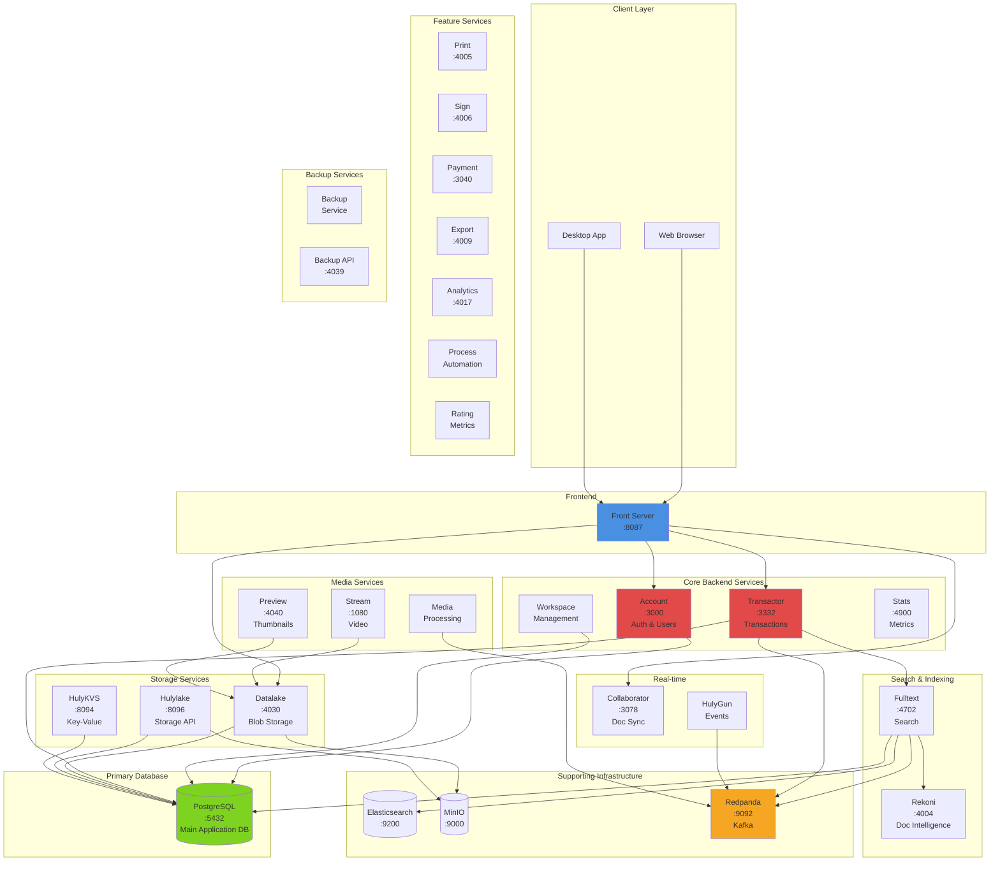
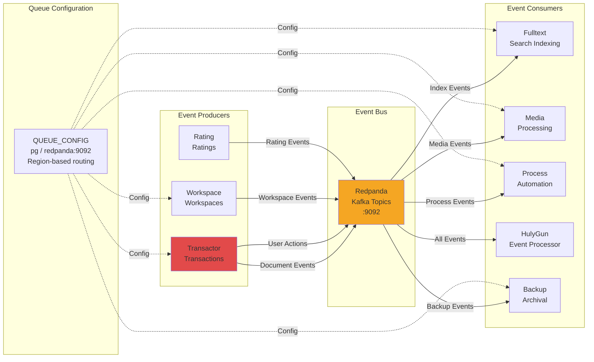
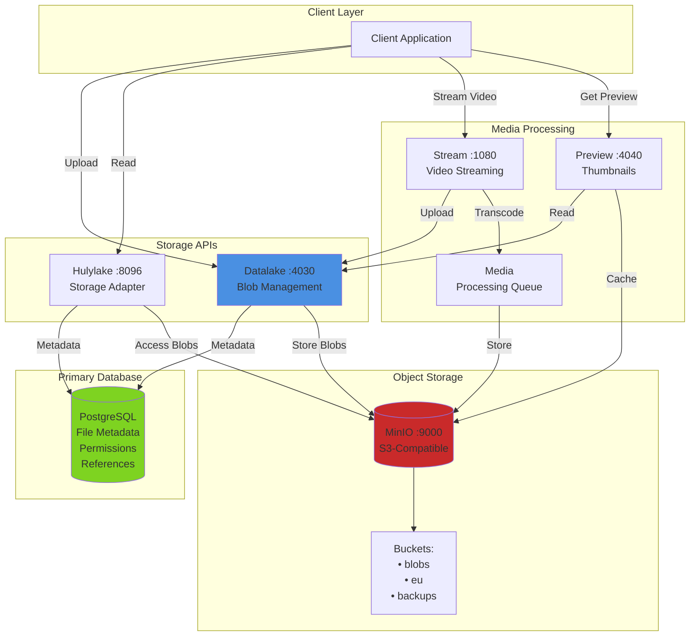
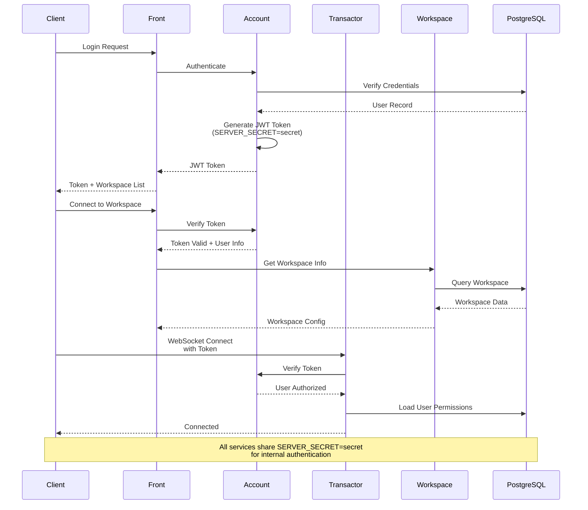

# Huly Platform Architecture Overview

## Service Overview

The Huly platform consists of **30+ microservices** working together in a distributed architecture. Services are organized into functional layers for core business logic, data storage, real-time communication, media processing, and supporting features.

### Core Backend Services

| Service | Port | Description |
|---------|------|-------------|
| **account** | 3000 | Authentication and user management. Handles login, registration, JWT tokens, workspace membership, and user permissions. |
| **transactor** | 3332 | Core transaction processing engine. Maintains WebSocket connections for real-time updates, processes all data mutations, enforces business logic, and publishes events to the message queue. |
| **workspace** | - | Workspace lifecycle management. Handles workspace creation, initialization, upgrades, and maintenance background jobs. |
| **stats** | 4900 | Metrics collection and aggregation. Collects usage statistics and health metrics from all services for monitoring. |

### Storage & Data Services

| Service | Port | Description |
|---------|------|-------------|
| **datalake** | 4030 | Blob storage management with metadata. Handles file uploads, permissions, and coordinates with MinIO for object storage. |
| **hulylake** | 8096 | Storage adapter API. Provides S3-compatible interface for accessing stored objects. |
| **hulykvs** | 8094 | Key-value store service. Fast storage for configuration, preferences, and cached data. |

### Search & Indexing

| Service | Port | Description |
|---------|------|-------------|
| **fulltext** | 4702 | Full-text search indexing. Consumes events, extracts content, maintains Elasticsearch index for fast searches. |
| **rekoni** | 4004 | Document intelligence service. Extracts text and structured data from binary documents (PDF, DOC, DOCX, RTF, HTML) for searchability and resume parsing. Supports HeadHunter, LinkedIn, and generic resume formats. |

### Real-time Services

| Service | Port | Description |
|---------|------|-------------|
| **collaborator** | 3078 | Real-time document collaboration using Y.js CRDT. Enables simultaneous editing with conflict resolution. |
| **hulygun** | - | Event processor. Consumes and processes events from Redpanda for real-time updates. |

### Media Services

| Service | Port | Description |
|---------|------|-------------|
| **stream** | 1080 | Video streaming service with HLS transcoding for recording playback. |
| **media** | - | Media processing queue. Handles video/audio conversion and optimization. |
| **preview** | 4040 | Thumbnail and preview generation for images and documents. |

### Feature Services

| Service | Port | Description |
|---------|------|-------------|
| **print** | 4005 | PDF generation service for printing documents and reports. See [Document printing](docs/printing.md) for the export flow, authorization, rendering readiness, and browser debugging. |
| **sign** | 4006 | Digital signature service for document signing with certificates. |
| **payment** | 3040 | Payment and billing integration (Polar). Handles subscriptions and payments. |
| **export** | 4009 | Data export service for workspace backups and data extraction. |
| **analytics** | 4017 | Analytics event collection and processing. |
| **process** | - | Workflow automation and process orchestration. |
| **rating** | - | Content rating and quality metrics. |

### Backup Services

| Service | Port | Description |
|---------|------|-------------|
| **backup** | - | Automated backup service. Periodically backs up workspace data to object storage. |
| **backup-api** | 4039 | Backup REST API. Provides endpoints for backup management and restoration. |

### Frontend

| Service | Port | Description |
|---------|------|-------------|
| **front** | 8087/8088 | Web application server. Serves the Huly UI, handles static assets and client-side routing. |

### Infrastructure (Databases & Message Queues)

| Service | Port(s) | Description |
|---------|---------|-------------|
| **postgres** | 5432 | **PostgreSQL - Primary Application Database**. Stores ALL business data: users, workspaces, documents, transactions, metadata, permissions. Relational database with ACID guarantees. |
| **elastic** | 9200 | Elasticsearch search engine. Stores full-text search indexes managed by fulltext service. |
| **minio** | 9000, 9001 | S3-compatible object storage. Stores binary files, attachments, images, and blobs in buckets (blobs, eu, backups). |
| **redpanda** | 9092, 19092 | Kafka-compatible event streaming. Provides reliable async messaging between services. |

### Monitoring & Observability

| Service | Port | Description |
|---------|------|-------------|
| **jaeger** | 16686, 4318 | Distributed tracing UI and OTLP collector. All services send traces for performance monitoring. |
| **redpanda_console** | 8000 | Kafka management UI for monitoring topics, consumers, and message flow. |

### Service Communication Patterns

- **Synchronous (HTTP/WebSocket)**: Client ↔ Front ↔ Backend Services
- **Asynchronous (Events)**: Producers (Transactor, Workspace) → Redpanda → Consumers (Fulltext, Media, Process)
- **Primary Database**: All services → PostgreSQL (main application data)
- **Search Index**: Fulltext → Elasticsearch
- **Object Storage**: Services → MinIO (S3 API)
- **Real-time Updates**: Client ↔ Transactor (WebSocket), Client ↔ Collaborator (WebSocket)

---

## 1. High-Level System Architecture



---


## 2. Event-Driven Architecture (Redpanda/Kafka)



---

## 3. Storage Architecture



---

## 4. Authentication & Authorization Flow



---

## Service Summary Table

| Service | Container | Port | Purpose | Dependencies |
|---------|-----------|------|---------|--------------|
| **Frontend** | | | | |
| front | tracexapp/front | 8087/8088 | Web application server | account, transactor, collaborator, datalake |
| **Core** | | | | |
| account | tracexapp/account | 3000 | Authentication & user management | postgres, redpanda, stats |
| transactor | tracexapp/transactor | 3332 | Transaction processing (WebSocket) | postgres, redpanda, fulltext, account |
| workspace | tracexapp/workspace | - | Workspace management | postgres, redpanda, minio, account |
| stats | tracexapp/stats | 4900 | Metrics collection | - |
| **Storage** | | | | |
| datalake | tracexapp/datalake | 4030 | Blob storage & metadata | postgres, minio, account |
| hulylake | tracexapp/hulylake | 8096 | Storage adapter API | postgres, minio |
| hulykvs | tracexapp/hulykvs | 8094 | Key-value store | postgres |
| **Search** | | | | |
| fulltext | tracexapp/fulltext | 4702 | Full-text search indexing | elasticsearch, postgres, rekoni, redpanda |
| rekoni | tracexapp/rekoni-service | 4004 | Document intelligence | stats |
| **Real-time** | | | | |
| collaborator | tracexapp/collaborator | 3078 | Real-time document collaboration | account, datalake, transactor |
| hulygun | tracexapp/hulygun | - | Event processor | redpanda, account |
| **Media** | | | | |
| stream | tracexapp/stream | 1080 | Video streaming | datalake, redpanda |
| media | tracexapp/media | - | Media processing | redpanda, account |
| preview | tracexapp/preview | 4040 | Thumbnail generation | datalake |
| **Features** | | | | |
| print | tracexapp/print | 4005 | PDF generation | postgres, minio, account |
| sign | tracexapp/sign | 4006 | Digital signatures | postgres, minio, account |
| payment | tracexapp/payment | 3040 | Payment processing | account |
| export | tracexapp/export | 4009 | Data export | postgres, minio, account |
| analytics | tracexapp/analytics-collector | 4017 | Analytics collection | account, stats |
| process | tracexapp/process | - | Workflow automation | redpanda, account |
| rating | tracexapp/rating | - | Content rating | postgres, redpanda, account |
| **Backup** | | | | |
| backup | tracexapp/backup | - | Automated backup | postgres, minio, account |
| backup-api | tracexapp/backup-api | 4039 | Backup REST API | minio, account |
| **Primary Database** | | | | |
| postgres | postgres:16 | 5432 | **Main application database** - stores users, workspaces, documents, transactions, metadata, permissions | - |
| **Supporting Infrastructure** | | | | |
| elastic | elasticsearch:7.14.2 | 9200 | Search engine for full-text indexes | - |
| minio | minio/minio | 9000, 9001 | Object storage (S3) for files and blobs | - |
| redpanda | redpandadata/redpanda:v24.3.6 | 9092, 19092 | Event streaming (Kafka) for async processing | - |
| **Monitoring** | | | | |
| jaeger | jaegertracing/all-in-one | 16686, 4318 | Distributed tracing and performance monitoring | - |
| redpanda_console | redpandadata/console:v2.8.3 | 8000 | Kafka management UI | redpanda |

---

## Environment Variables Summary

### Common Configuration (Shared by Most Services)
- `SERVER_SECRET` / `SECRET`: `secret` - Shared authentication secret
- `REGION`: `pg` - Deployment region identifier
- `ACCOUNTS_URL`: `http://tracex.local:3000` - Account service URL
- `STATS_URL`: `http://tracex.local:4900` - Metrics collection URL
- `OTEL_EXPORTER_OTLP_ENDPOINT`: `http://jaeger:4318/v1/traces` - Tracing endpoint
- `STORAGE_CONFIG`: `${STORAGE_CONFIG}` - MinIO connection string
- `QUEUE_CONFIG`: `${QUEUE_CONFIG}` - Redpanda/Kafka configuration

### Database Configuration
- `DB_URL` / `DB_URL_PG`: PostgreSQL connection string
- `FULLTEXT_DB_URL`: `http://tracex.local:9200` - Elasticsearch URL
- `HULY_DB_CONNECTION`: PostgreSQL connection for Huly* services

### Storage Configuration
- `STORAGE_CONFIG`: MinIO configuration (format: `minio|minio?accessKey=minioadmin&secretKey=minioadmin`)
- `AWS_ENDPOINT_URL`: `http://minio:9000` - S3-compatible endpoint
- `AWS_ACCESS_KEY_ID`: `minioadmin`
- `AWS_SECRET_ACCESS_KEY`: `minioadmin`
- `BUCKETS`: `blobs,eu|http://minio:9000?accessKey=minioadmin&secretKey=minioadmin` - Datalake bucket configuration

### Queue Configuration
- `QUEUE_CONFIG`: `redpanda:9092` - Region-based event routing
- `HULY_KAFKA_BOOTSTRAP`: `redpanda:9092` - Kafka bootstrap servers

### Service URLs (Internal)
- `ACCOUNTS_URL`: `http://tracex.local:3000`
- `TRANSACTOR_URL`: `ws://tracex.local:3332`
- `FULLTEXT_URL`: `http://tracex.local:4702`
- `REKONI_URL`: `http://tracex.local:4004`
- `COLLABORATOR_URL`: `ws://tracex.local:3078`
- `DATALAKE_URL`: `http://tracex.local:4030`
- `HULYLAKE_URL`: `http://tracex.local:8096`
- `PREVIEW_URL`: `http://tracex.local:4040`
- `STREAM_URL`: `http://tracex.local:1080/recording`
- `PAYMENT_URL`: `http://tracex.local:3040`
- `PRINT_URL`: `http://tracex.local:4005`
- `SIGN_URL`: `http://tracex.local:4006`
- `BACKUP_URL`: `http://tracex.local:4039/api/backup`
- `AI_BOT_URL`: `http://tracex.local:4010`

### Frontend Configuration
- `FILES_URL`: `http://tracex.local:4030/blob/:workspace/:blobId/:filename` - File download URL pattern
- `FRONT_URL`: `http://tracex.local:8087` - Frontend base URL
- `BRANDING_URL`: `http://tracex.local:8087/branding.json`
- `DESKTOP_UPDATES_URL`: `https://dist.tracex.co`

### Authentication & Security
- `HULY_TOKEN_SECRET`: `secret` - Token signing for Huly services
- `SERVER_SECRET`: `secret` - Service-to-service auth
- `ADMIN_EMAILS`: Admin user emails
- `LAST_NAME_FIRST`: `true` - Name formatting preference

### Feature Flags
- `ENABLE_COMPRESSION`: `true` - Transactor compression

### Rate Limiting (Transactor)
- `RATE_LIMIT_MAX`: `250` - Requests per window
- `RATE_LIMIT_WINDOW`: `30000` - 30 seconds

### Workspace Configuration
- `WS_OPERATION`: `all+backup` - Operation mode
- `WORKSPACE_LIMIT_PER_USER`: `10000`
- `REGION_INFO`: `pg|PostgreSQL` - Available regions

### Backup Configuration
- `BUCKET_NAME`: `backups`
- `BACKUP_STORAGE`: `${BACKUP_STORAGE_CONFIG}`
- `INTERVAL`: `60` - Backup interval in second
### Stream Service
- `STREAM_ENDPOINT_URL`: `datalake://tracex.local:4030`
- `STREAM_INSECURE`: `true`
- `STREAM_MAX_PARALLEL_SCALING_COUNT`: `6`

---

## Troubleshooting Guide

### Service Health Verification

```bash
# Check all services
docker ps

# Check individual service logs
docker logs -f [container_id]
```
